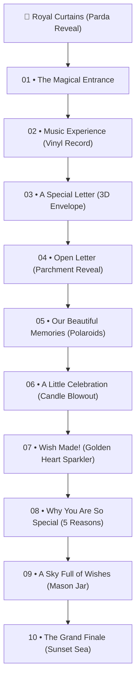

# ✨ Happy Birthday Divya ♡ | A Million-Dollar Cinematic Surprise

<div align="center">


### 🎂 *"A Little World Made Just For You ♡"*
**Dedicated to my lazy, wonderful sister Divya on her 3rd December Birthday.**  
*Crafted with infinite love, banter, and code by her brother Vinay.*

---

</div>

## 🌟 The Vision: A $1,000,000 Cinematic Birthday Experience
This is not an ordinary, flat template website. It is an **interactive cinematic web experience** designed mobile-first in an authentic 9:16 portrait format (like an Instagram Story / immersive TikTok experience), featuring buttery-smooth scroll snapping, real physics, custom sound design, and heartwarming sibling banter.

---

## 🎭 The Journey Through The Chapters



### ✨ Chapter Highlights:
1. **👑 Grand Royal Curtains (Parda Reveal):**
   - Deep royal burgundy & purple velvet curtains with 3D pleat shading, golden festoons, hanging fairy lights, and golden tassels.
   - Shows **"The Special Day ♡"**, **"3 December"**, and an ornate royal arched portrait of Divya.
   - On tap: **Cinematic slow-motion curtain parting (2.2s)** with golden starburst confetti that smoothly auto-starts the song!
2. **01 • The Magical Entrance:**
   - Wisteria & rose stone archway with flickering lanterns, warm ambient glows, and glowing invitation button.
3. **02 • Music Experience:**
   - 3D spinning vinyl record with center album art, real-time dynamic audio equalizer bars, and floating water lanterns.
   - Song: *"Dilruba Dilnasheen"* (by Rito Riba) starting right at the chorus!
4. **03 • A Special Letter:**
   - Blush pink sealed envelope tied with rustic twine and miniature dried roses.
   - Tap envelope or wax seal -> wax seal pops with golden starburst -> parchment letter physically slides UP out of the envelope!
5. **04 • Open Letter (The Real Banter):**
   - Antique deckled-edge parchment paper with authentic curled corner.
   - Centralized playful sibling letter with reels, screentime teasing, exam jokes, and deep brotherly affection.
6. **05 • Our Beautiful Memories:**
   - 3 Polaroid photo frames suspended on cherry blossom strings with washi tape slaps and physics tilt rotations.
7. **06 • A Little Celebration (Real Candle Blowout):**
   - 2-tiered pink drip cake with edible butterfly toppers on a golden stand with 4 glowing candles.
   - **Interactive Blowout:** Tap the candles -> flames realistically extinguish into unlit wicks with glowing red embers + curling smoke wisps + screen flash + celebratory confetti pop!
8. **07 • Wish Made!:**
   - Extinguished cake beneath a radiant golden neon heart sparkler with 12 sunburst rays and sparkling stars.
9. **08 • Why You Are So Special:**
   - 5 ivory scalloped cards cascading in with 3D embossed icon badges (Smile, Kind Heart, Strength, Little Joys, Happiness You Bring).
10. **09 • A Sky Full of Wishes:**
    - Full moon twilight sky with floating paper lanterns and fireflies.
    - Corked 3D glass wish jar with interactive 3D flipping wish card.
11. **10 • The Grand Finale:**
    - Sunset sea horizon with brother-sister silhouette portrait, glowing neon heart, emotional quote, brother's signature plaque, and a 3-wave confetti explosion button.

---

## 🛠️ Tech Stack & Architecture

- **Core:** React 18, TypeScript, Vite
- **Styling:** Tailwind CSS, Custom Glassmorphism, 3D CSS Transforms
- **Animations:** GSAP 3.12 (ScrollTrigger, Timeline, Physics), Canvas Confetti
- **Audio Engine:** Custom HTML5 Web Audio Controller with looping, mute/unmute, and SFX
- **Optimization:** 100dvh CSS snap-scrolling, zero-overflow boundaries, hardware-accelerated transforms (`will-change`)

---

## 🚀 Quick Start (Local Development)

### 1. Clone the repository:
```bash
git clone https://github.com/VinayKumarMakvana/Divya-s-Birthday.git
cd Divya-s-Birthday
```

### 2. Install dependencies:
```bash
npm install
```

### 3. Run development server:
```bash
npm run dev
```
Open [http://localhost:5173](http://localhost:5173) in your browser.  
*(Press `F12` and switch to Mobile View / iPhone 14 Pro Max for the intended vertical portrait experience!)*

### 4. Build for production:
```bash
npm run build
```

---

## ⚡ Deployment to Vercel (Step-by-Step)

### Option A: 1-Click GUI Deployment (Easiest & Recommended)
1. Go to [vercel.com](https://vercel.com/) and Sign In with your GitHub account.
2. Click **"Add New..."** -> **"Project"**.
3. Import your repository: `VinayKumarMakvana/Divya-s-Birthday`.
4. Vercel automatically detects **Vite**:
   - **Framework Preset:** `Vite`
   - **Build Command:** `npm run build`
   - **Output Directory:** `dist`
   - **Install Command:** `npm install`
5. Click **"Deploy"**! Within 60 seconds, your site will be live on a fast global CDN with free SSL!

### Option B: Deploy via Vercel CLI (From Terminal)
```bash
# 1. Install Vercel CLI globally (if not installed)
npm install -g vercel

# 2. Login to your Vercel account
vercel login

# 3. Deploy directly from your project directory
vercel

# 4. For production release:
vercel --prod
```

---

## 💌 A Personal Note for Divya

> *"Dear lazy Divya,*  
> *Hamesha khush raho or apne bare me socho, duniya jaye bhad me!*  
> *Din bhar reels dekho, mobile chalao, aur itni tarakki karo ki log hairan reh jayein.*  
> *I feel truly lucky to have a sister like you.*  
>  
> *With lots of love,*  
> **Your Brother Vinay ♡**"

---

<div align="center">
Made with ❤️ by <a href="https://github.com/VinayKumarMakvana">Vinay Kumar Makvana</a> for his sister Divya.
</div>
